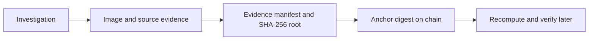

<div align="center">
  

  <p>
    
    
    
    <a href="LICENSE"></a>
  </p>
</div>

## 🧾 What it does

PaperTrail is an image-investigation prototype built around evidence integrity. It organizes an investigation, records discovered media and related evidence, fingerprints the evidence set, and can anchor or verify that fingerprint with an Ethereum contract.

Image matching is a discovery aid. A match is not proof of who created or depicted an image, and the product should not be treated as biometric identification.

## 🎞️ Evidence workflow

<p align="center">
  
  
  
</p>



## 🧩 Main pieces

- Next.js app with investigation, evidence, graph, timeline, and verification routes.
- Shared package for typed evidence and hashing logic.
- Solidity anchoring contract and scripts for evidence verification.
- CI, unit/browser tests, fixtures, and a secret-scanning script are included.

## 🧰 Stack

| Area | Tools |
|---|---|
| Web | Next.js 15, React, TypeScript |
| Contract | Solidity 0.8.x, Ethereum tooling |
| Evidence | SHA-256 manifests, shared TypeScript package |
| Quality | Vitest, Playwright, GitHub Actions |

## 🚀 Run locally

Requires Node.js 20+ and npm.

```bash
git clone https://github.com/ChristopherJoshy/PaperTrail.git
cd paper-trail
npm ci
cp .env.example .env
npm run dev
```

In PowerShell, use `Copy-Item .env.example .env`. Configure only the providers you need. Local demo fixtures and evidence verification are available through the scripts:

```bash
npm test
npm run typecheck
npm run verify-evidence
npm run scan:secrets
```

## 🗂️ Layout

```text
apps/web/       Next.js investigation and verification UI
packages/shared shared evidence models and logic
contracts/      on-chain evidence anchor
scripts/        pipeline and verification utilities
docs/images/    recorded workflow GIFs
```

## 📄 License

MIT. See [`LICENSE`](LICENSE).

## ⚠️ Scope

An on-chain digest can show that bytes match a previously committed fingerprint; it cannot establish that a source is truthful, that an image is authentic, or that a person is correctly identified.